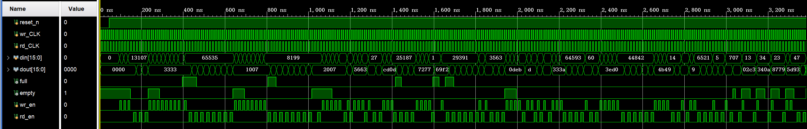

# Asy_FIFO — 异步 FIFO
基于格雷码读写指针的异步 FIFO，写/读时钟相互独立，复位采用"异步复位、同步释放"。
本设计支持非 2 幂深度（depth 取 5、6、7 等可直接例化），并对写溢出 / 读下溢给出单周期脉冲指示。
## 特性
- 写/读双时钟独立，跨时钟域采用格雷码指针 + 两级触发器同步
- 支持非 2 幂深度：内部存储深度自动向上取整到 2 的幂，满判断基于数据计数而非指针最高位比较
- 异步复位、同步释放，复位释放分别同步到 wr_CLK / rd_CLK 域
- full / empty / almost_full / almost_empty 标志，阈值参数化
- overflow / underflow 单周期脉冲指示
## 参数
- width：数据位宽，默认 16
- depth：FIFO 深度，默认 8，不要求是 2 的幂（需 ≥ 2）；内部存储深度为不小于 depth 的最小 2 的幂
- ptr_width：指针位宽，默认 $clog2(depth)+1，比地址宽 1 bit，一般保持默认
- almost_full_th：将满阈值，默认 depth-2，FIFO 内数据数 ≥ 该值时 almost_full 拉高
- almost_empty_th：将空阈值，默认 2，FIFO 内数据数 ≤ 该值时 almost_empty 拉高
## 接口
输入：
- reset_n：异步复位，低有效
- wr_CLK / rd_CLK：写时钟 / 读时钟
- wr_en：写使能，full 时写入被忽略并置 overflow
- rd_en：读使能，empty 时读取被忽略并置 underflow
- din：写数据
输出：
- dout：读数据，寄存器输出，读使能后 1 拍有效
- full / empty：满 / 空标志
- almost_full / almost_empty：将满 / 将空标志
- overflow / underflow：溢出 / 下溢脉冲，拉高 1 拍
## 设计说明
### 1. 非 2 幂深度支持
传统异步 FIFO 的满判断用"指针最高位不同、其余位相同"，这隐含要求 depth 必须是 2 的幂。
本设计改为计数比较：写时钟域内用「写指针 − 同步后的读指针」得到当前数据计数，计数 ≥ depth 即判满。因此 depth 不必是 2 的幂，内部 RAM 深度按 $clog2 向上取整，指针自由递增、自然绕回，由计数逻辑保证不会写满存储空间。
### 2. 跨时钟域同步
读写指针在各自时钟域内二进制递增、格雷码输出，经两级触发器同步到对方时钟域后，用 gray_2bin 函数转回二进制做比较。格雷码相邻状态仅 1 bit 翻转，可将同步引入的亚稳态概率降到可接受水平。
### 3. 满 / 空判断
- 写域判满：wr_fifo_cnt = 写指针 − 同步后的读指针，cnt ≥ depth 置满
- 读域判空：下一拍读指针（格雷码）与同步后的写指针（格雷码）相等即空
- 将满 / 将空：wr_fifo_cnt / rd_fifo_cnt 与参数化阈值比较
### 4. 异步复位同步释放
reset_n 异步拉低，在写、读时钟域各经两级触发器延迟后释放，避免复位撤除时机不当引入亚稳态。复位期间 full / overflow / underflow 清零，empty / almost_empty 置一。
### 5. 标志信号时序
full / empty / almost_* 为寄存器输出，相对 FIFO 实际状态滞后最多 1 拍；overflow / underflow 为单周期脉冲。
## 验证
Testbench 内置参考模型（model_mem + 读写指针 + 计数器），每次读数据自动与模型比对，任一处不符立即打印 FAIL 并终止；另设 10 μs 看门狗防止仿真挂死。
- TP1：复位后初态 —— empty=1、full=0、dout=0
- TP2：3 写 3 读，回读数据比对
- TP3：连续写满 depth 个 → 检查 full → 满时写触发 overflow → 全部读出核对
- TP4：写满读空 → 检查 empty → 空时读触发 underflow
- TP5：100 次随机读写混合（依参考模型计数决定操作），最后排空并核对计数清零
测试时钟：wr_CLK 100 MHz（10 ns），rd_CLK ≈ 71.4 MHz（14 ns），异步且非整数倍。
仿真波形：

## 综合结果
### 标准单元综合
流程：`synth → dfflibmap -liberty → abc -liberty → stat -liberty`，映射到开源 SkyWater 130nm 工艺库：
- Chip area：6817.79 µm²
- 其中时序单元 5247.53，占 76.97%——异步 FIFO 的面积大头在 CDC 同步器、双份指针与 RAM 写口寄存器，组合逻辑（格雷码 XOR 链、计数比较器）仅约 23%
- 输出映射后门级网表 netlist.v，单元名为 `sky130_fd_sc_hd__*`
## 可改进点
- 读数据为寄存器输出，读延迟 1 拍；如需 FWFT（first-word fall-through）需加一级输出寄存器
- overflow / underflow 目前仅作指示，可补 SVA 断言做协议级检查
- 随机测试次数与种子固定，可接入随机种子做回归
